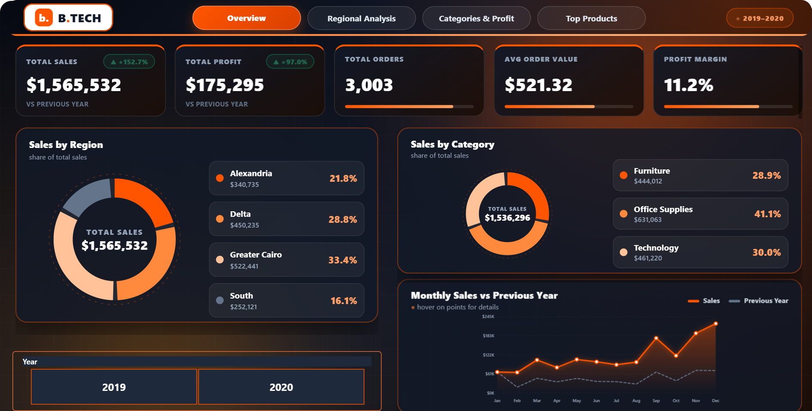
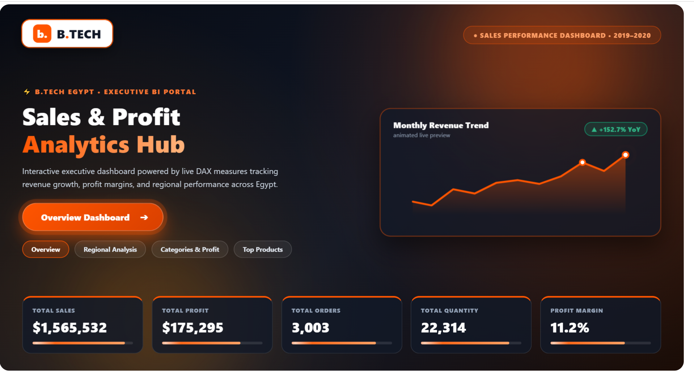
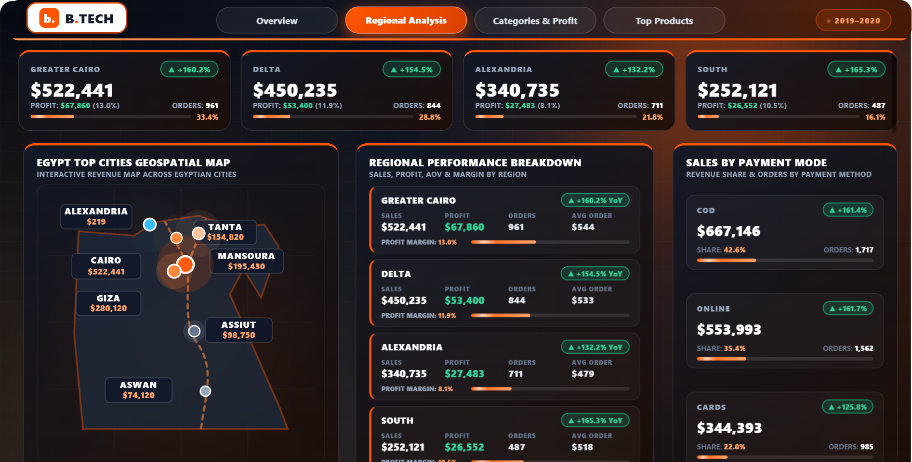
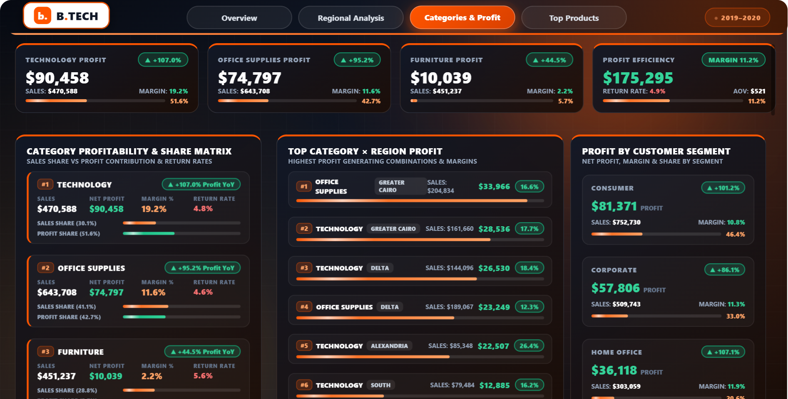
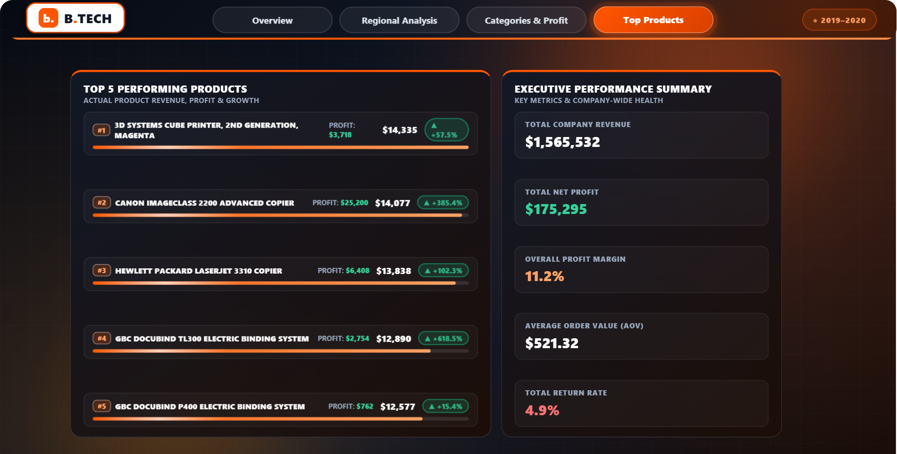

# B.TECH Executive Sales & Performance Dashboard (Power BI)

A 4-page executive sales dashboard built in Power BI, with custom HTML/CSS/SVG visuals rendered through DAX measures in the HTML Content custom visual.

## Data Source

This project is built on the **Superstore sample dataset** (5,901 order lines, 2019-2020), re-themed to an Egyptian retail context: the US regions are mapped to Egyptian regions (Greater Cairo, Delta, Alexandria, South) and the report is branded for B.TECH. The dataset is included in this repo as `SuperStore_Sales_Dataset.csv`. All figures come from that dataset, not from B.TECH's real operations.

## Key Findings (2019-2020)

- **$1.57M total sales** across 3,003 orders, **$175K net profit** at an 11.2% margin, $521 average order value.
- Sales grew **+152.7% YoY** (2020 vs 2019); the return rate is 4.9%.
- **Greater Cairo** is the top region with $522K (33.4% of sales); South is the smallest at $252K (16.1%).
- Office Supplies lead sales ($644K, 41.1%), but **Technology is the profit engine**: $90K profit at a 19.2% margin, while Furniture sells $451K for only $10K profit (2.2% margin).
- The **Consumer segment** generates the most profit: $81K of the $175K total (46.4%).
- Cash on delivery is the leading payment mode at $667K (42.6% of revenue), ahead of Online ($554K) and Cards ($344K).

## Dashboard Pages

1. **Overview (Executive Summary):** KPI cards for Sales, Profit, Orders, AOV, and Profit Margin with YoY indicators; Sales by Region and Sales by Category donuts; Monthly Sales vs Previous Year trend.
2. **Regional Analysis:** geospatial map of Egyptian cities plus a sales, profit, and AOV breakdown by region and by payment mode.
3. **Categories & Profit:** category profitability matrix with return rates, top Category x Region profit combinations, and profit by customer segment.
4. **Top Products & Executive Summary:** top 5 products by revenue with profit and growth, plus company-wide health metrics.

## More Screenshots

| Landing | Regional Analysis |
|---|---|
|  |  |

| Categories & Profit | Top Products |
|---|---|
|  |  |

## Technical Highlights

- **Advanced DAX:** measure modeling with `ADDCOLUMNS`, `SUMMARIZE`, `RANKX`, `CALCULATE`, and dynamic YoY growth calculations.
- **HTML/CSS visuals:** custom cards, grids, progress bars, and hover effects rendered in the HTML Content visual.
- **Animations:** CSS keyframes (`popIn`, `sweep`, `blink`, `fillBar`) for a web-app feel.
- **Theme:** dark mode (`#111827`) with orange accents (`#FF5500`) matching the B.TECH brand.

## How to View

1. Download `sales.pbix` from this repo.
2. Open it in **Power BI Desktop** and use the page navigation buttons at the top.
